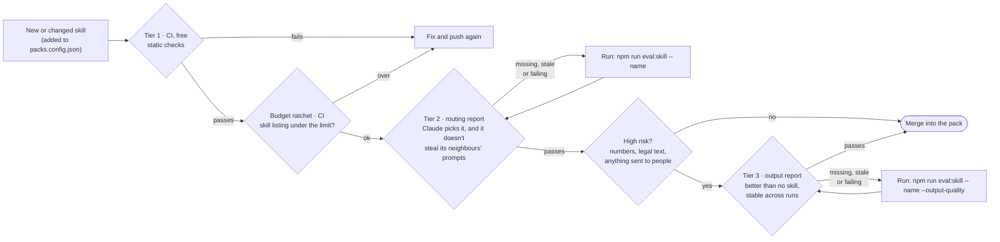

# Utopia Skills

[](https://github.com/The-Utopia-Studio/skills/actions/workflows/ci.yml)
[](https://skills.sh/The-Utopia-Studio/skills)

**The best GTM skill pack for AI agents** — plus Product, Investments, and Founder Productivity.

254 production skills for Claude Code, Cursor, and any tool that supports the [Agent Skills Standard](https://agentskills.io). Operator judgment, not tip lists.

> **Site:** [the-utopia-studio.github.io/skills](https://the-utopia-studio.github.io/skills) · **Install:** [INSTALL.md](./INSTALL.md) (~2 minutes)

## Why Utopia Skills

skills.sh is flooded with unverified dumps. Utopia ships **curated playbooks**: rubrics, approval rails, deliverability, deal velocity, warm intros, tech DD, pitch decks — adapted from Studio and funds-team work.

| You want… | Install |
|-----------|---------|
| GTM that actually closes | `utopia-gtm` |
| Discovery → design → deploy | `utopia-product` |
| DD, modeling, fundraising | `utopia-investments` |
| Onboarding, notes, agents | `utopia-founder-productivity` |

## Quick install (Claude Code)

Paste into Claude Code:

```
Install the Utopia Skills marketplace for me.

1. Register the marketplace:
   /plugin marketplace add The-Utopia-Studio/skills

2. Install all four modules:
   /plugin install utopia-gtm@skills
   /plugin install utopia-product@skills
   /plugin install utopia-investments@skills
   /plugin install utopia-founder-productivity@skills

3. Confirm what's installed and tell me how to update later with:
   /plugin marketplace update skills

If any step fails, explain what went wrong and how to fix it.
Don't invent pack names — use only the four above.
```

Already installed? Refresh:

```
/plugin marketplace update skills
```

## Single-skill installs (share these)

```bash
npx skills add The-Utopia-Studio/skills --skill cold-email
npx skills add The-Utopia-Studio/skills --skill outreach-execution
npx skills add The-Utopia-Studio/skills --skill account-tier-scoring
npx skills add The-Utopia-Studio/skills --skill pitch-deck
npx skills add The-Utopia-Studio/skills --skill technical-dd
npx skills add The-Utopia-Studio/skills --skill impeccable
```

Full library:

```bash
npx skills add The-Utopia-Studio/skills
```

## The four modules

| Module | Pack | Skills | Covers |
|--------|------|--------|--------|
| **GTM** | `utopia-gtm` `v3.0.0` | 50 | Seven sub-modules: strategy, comms, enablement, CS, BD, engineering, IP |
| **Product** | `utopia-product` `v3.0.0` | 134 | Discovery, PRDs, design, build, deploy, product metrics |
| **Investments** | `utopia-investments` `v3.0.0` | 42 | DD, modeling, valuation, capital markets, fundraising decks |
| **Founder Productivity** | `utopia-founder-productivity` `v3.0.0` | 28 | Onboarding, legal, Obsidian, agents, meta tools |

Exact lists: [`packs.config.json`](./packs.config.json).

Consolidation changes, measured routing results, and remaining test work:
[`Skill consolidation report`](./reports/2026-10-20-skill-consolidation/README.md).

### GTM highlights

| Skill | Use when… |
|-------|-----------|
| `cold-email` / `outreach-execution` | Outbound with peer tone + approval rails |
| `cold-email` / `account-tier-scoring` | Intent → prioritized outreach |
| `warm-intro-intelligence` | Warm paths into target accounts |
| `deal-velocity-engineer` / `revops-forecasting` | Stalled deals + forecast accuracy |
| `call-scorecards` / `agent-autonomy-levels` | Call coaching + agent autonomy levels |
| `email-deliverability` / `cold-offer-architect` | Inbox placement + offer quality before copy |

## Submit a skill with your AI

Paste this into Claude, Cursor, or any capable agent:

```
Fetch https://raw.githubusercontent.com/The-Utopia-Studio/skills/main/CONTRIBUTING.md and follow the sandbox → module graduation flow.

Interview me thoroughly about my skill — when it runs, what it produces, the full playbook with branches, real numbers/rubrics, worked examples, what experts notice first, common mistakes, and what good looks like.

Draft it as skills/sandbox/<skill-name>/SKILL.md with Utopia frontmatter (name + trigger-condition description). Put depth in references/ if needed. Then open a PR (or give me the files if you can’t use git).

Do not invent vendor lock-in. Use GTM/product verbs. Encode judgment, not a bare checklist.
```

Details: [`CONTRIBUTING.md`](./CONTRIBUTING.md).

## Adding a skill: the quality gate

Every skill that joins a pack, or changes its name or description, must show that it works before it merges. That matters because each skill has a cost even when it's good. Its description competes for a shared listing budget that Claude reads in every session, and it can take requests away from skills that already work. The gate checks both.



| Check | What it proves | Who runs it | Pass bar |
|---|---|---|---|
| **Tier 1: static checks** | The skill loads and is well-formed: valid frontmatter, a name that matches its folder, no broken paths, scripts that parse, no secrets or personal paths. A new skill also ships `evals/evals.json` (3+ test cases and a `risk` level) and `evals/triggers.tsv` (8+ prompts it should fire on, 8+ near misses it shouldn't) | CI, on every PR | No errors. Description up to 600 characters, with a "Use when …" clause |
| **Budget ratchet** | All the names and descriptions together still fit the budget Claude reads in every session | CI, on every PR | Total under `max_listing_chars` in [`scripts/skill-gate.config.json`](./scripts/skill-gate.config.json) |
| **Tier 2: routing** | Claude picks the skill for its own requests, ignores near misses, and doesn't take prompts from up to 8 neighbouring skills | You, before opening the PR (`npm run eval:skill -- <name>`) | Recall ≥ 0.8, at most 1 false fire, at most 1 stolen neighbour prompt, 3 runs per prompt |
| **Tier 3: output quality** | With the skill, Claude does the job better than without it, and does it reliably | You, for high-risk skills (`npm run eval:skill -- <name> --output-quality`) | Score ≥ 0.8, better than no skill on every case, 80% of cases pass all 3 trials |

**If a run is interrupted:** runs that time out or hit a usage limit are saved for that version of the skill. Running the same command again fills in only the missing runs, so you never pay twice for runs that finished.

**How the reports are trusted:** Tiers 2 and 3 run Claude, which needs your login and costs usage, so they don't run in CI. Each command writes a report into the skill's `evals/` folder, signed with a hash of the exact files it tested. CI accepts a report only if the hash still matches. If you edit the description after testing, the report goes stale and CI asks you to re-run.

**Step by step, for a new skill:**

1. Write the skill in `skills/<module>/<name>/` and add its name to [`packs.config.json`](./packs.config.json).
2. Add `evals/evals.json` (3+ realistic tasks, each with `expected_output`, `assertions`, and `"risk": "normal"` or `"high"`) and `evals/triggers.tsv` (`expected<TAB>group<TAB>prompt`; near misses name the skill that should win instead).
3. Run `npm run gate` to check Tier 1 and the budget locally.
4. Run `npm run eval:skill -- <name>`. For a high-risk skill, also run `npm run eval:skill -- <name> --output-quality`.
5. Commit the skill together with its `evals/*-report.json` files and open the PR. CI re-checks everything.

Which skills count as high risk is listed in [`scripts/skill-gate.config.json`](./scripts/skill-gate.config.json); a new skill declares its own risk in `evals.json`. When a reviewer agrees to an exception, record it in `<skill>/evals/gate-waiver.md`, one line on why. CI then accepts the missing report but prints the waiver in its log. The method behind the gate is the [`skill-eval`](./skills/founder-productivity/skill-eval/SKILL.md) skill.

## Layout

```
skills/
├── gtm/                      # → utopia-gtm (seven sub-modules)
│   ├── 01-growth-strategy/
│   ├── 02-marketing-comms/
│   ├── 03-sales-enablement/
│   ├── 04-customer-success/
│   ├── 05-bd-partnerships/
│   ├── 06-gtm-engineering/
│   └── 07-ip-commercialisation/
├── product/                  # → utopia-product
├── investments/              # → utopia-investments
├── founder-productivity/     # → utopia-founder-productivity
└── sandbox/                  # experiments before graduation

docs/                         # GitHub Pages site (utopia-default theme)
plugins/                      # generated by ./build-packs.sh
packs.config.json
```

## Maintainers

1. Skills live under `skills/<module>/<skill-name>/` (GTM: `skills/gtm/<submodule>/<skill-name>/`)
2. Add the name to [`packs.config.json`](./packs.config.json)
3. Run `./build-packs.sh` (needs `jq`)
4. Theme for the site: `npm run docs:theme` (syncs utopia-default into `docs/`)
5. Push — teammates refresh with `/plugin marketplace update skills`

## License

Apache 2.0
